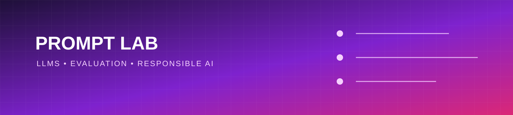

# LLM Prompt Engineering Lab

A practical, reproducible laboratory for learning prompt engineering with large language models (LLMs).

## Goals

- Compare zero-shot, few-shot, and structured prompts
- Document assumptions, inputs, outputs, and failure cases
- Practice reliable JSON and rubric-based responses
- Measure quality instead of relying on impressive examples

## Prompt experiment template

For every experiment, record the task, model configuration, exact prompt, evaluation criteria, failure cases, and next iteration.

## Responsible use

Do not include personal, confidential, copyrighted, or production secrets in prompts. Prompt results are model outputs and require verification.

## Roadmap

- [ ] Add reusable prompt templates
- [ ] Add a small evaluation dataset
- [ ] Add structured-output examples
- [ ] Compare prompts with a transparent scoring rubric
- [ ] Add multilingual examples, including Arabic and English

## License

MIT License. See [LICENSE](LICENSE).
